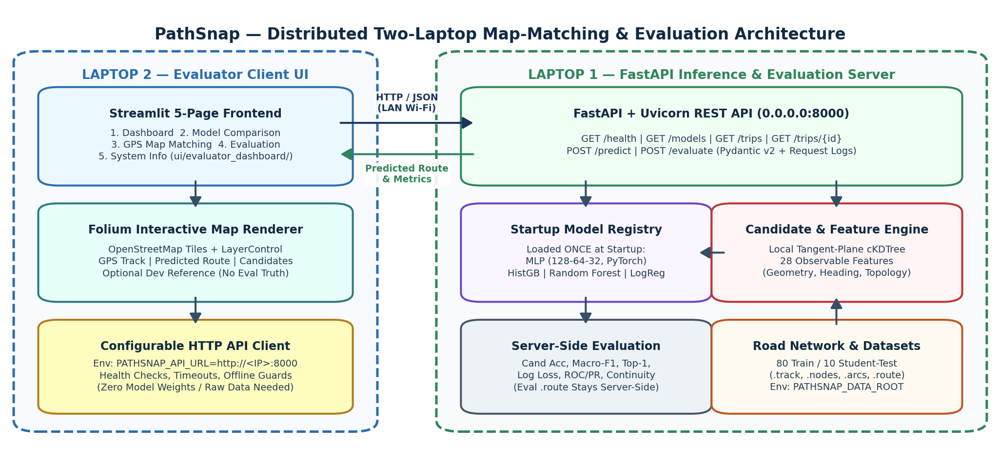
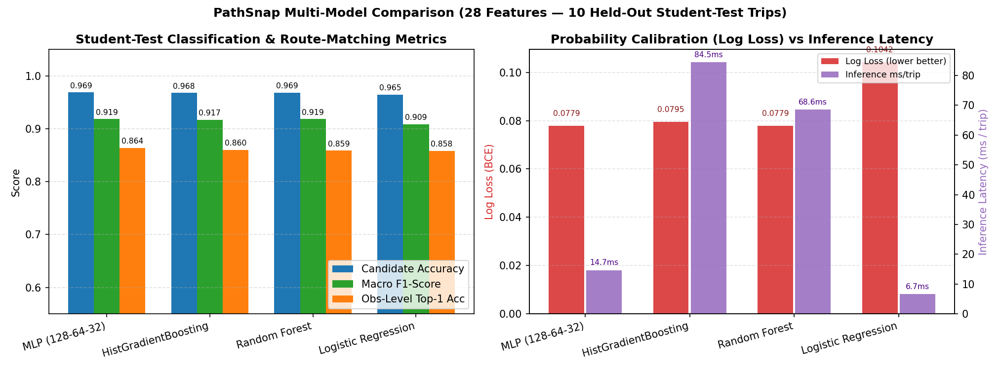
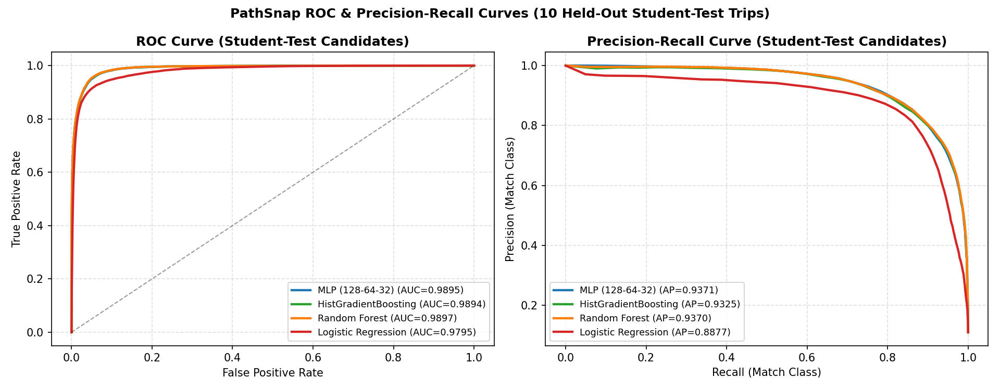
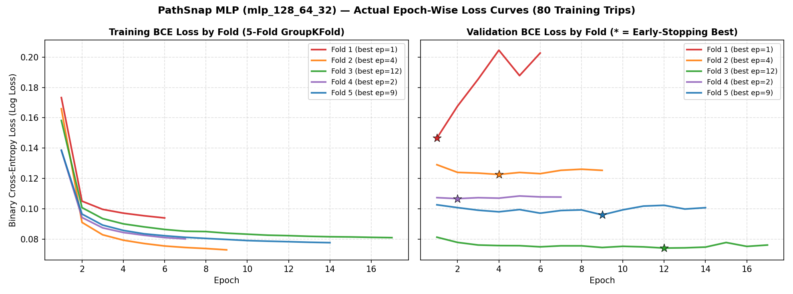
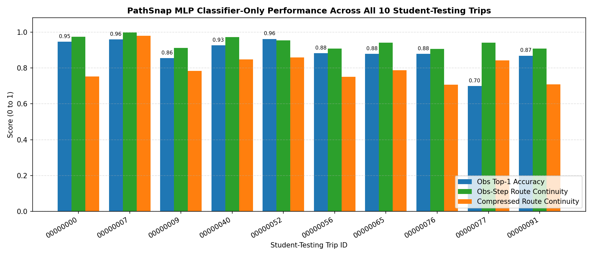

# PathSnap — Distributed Map-Matching & Route Reconstruction (Team 13)

**PathSnap** is an end-to-end distributed machine learning system developed for **PES University UE24CS352A: Machine Learning**. It reconstructs realistic vehicle trajectories by matching noisy GPS observations (`.track`) to directed road-network segments (`.nodes`, `.arcs`) using multi-model candidate scoring, a **FastAPI + Uvicorn** inference backend (**Laptop 1**), and an interactive **5-page Streamlit + Folium** evaluator dashboard (**Laptop 2**).



---

## Problem Statement

Urban GPS trajectories suffer from multipath reflections, building occlusion, signal drift, and irregular time gaps. Because `.route` reference sequences are ~5–7× shorter than `.track` GPS logs and each trip has its own local 0-based `arc_id` indexing (`649`–`307,392` arcs), PathSnap formulates map-matching as **binary candidate road-segment scoring** over `(observation, candidate_arc)` pairs using **28 observable physical, directional, kinematic, topological, and competitive-ranking features**. Per-candidate sigmoid probabilities are normalized per observation to produce `emission_prob` and `log_emission_prob` ready for both Observation-Level Top-1 decoding and downstream HMM/Viterbi sequence decoding.

---

## Key Features

- **Leak-Free 28-Feature Pipeline:** Per-trip local tangent-plane metric projection (handles global coordinates), 25 m sub-segment sampled `cKDTree` spatial candidate generation (`K = 12`, `r = 75 m`), exact $O(T \cdot R)$ vectorized monotonic DP label alignment, and 5-fold trip-grouped `GroupKFold` cross-validation.
- **Apples-to-Apples Multi-Model Comparison (4 Distinct Algorithm Families):** PyTorch MLP (`mlp_128_64_32`), `HistGradientBoosting`, `RandomForest`, and `LogisticRegression` trained on the exact same 80 `train` trips and evaluated on the 10 held-out `student_test` trips (`evaluator_test` never touched).
- **Production FastAPI Backend (`api/`):** Startup singleton `ModelRegistry` (loads all models once at startup), Pydantic v2 schemas, dual-mode `POST /predict` (trip-level & raw candidates), `POST /evaluate`, live request logging, and server-side evaluation guard.
- **5-Page Streamlit + Folium Evaluator Frontend (`ui/evaluator_dashboard/`):** Dashboard, Model Comparison, GPS Map Matching (5-layer OpenStreetMap Folium visualization), Evaluation (Confusion Matrix, real ROC & PR curves, CSV/JSON downloads), and System Information.
- **Two-Laptop Network Deployment:** Configurable `PATHSNAP_API_URL` environment variable with no hardcoded IP addresses and independent Python environments per laptop.

---

## Verified Experimental Results (10 Held-Out `student_test` Trips, 28 Features)

| Model | Family | CV Macro F1 | Student-Test Cand Acc | Student-Test Macro F1 | Student-Test Obs Top-1 | Log Loss | ROC-AUC | PR-AUC | Obs Continuity | Infer (ms/trip) |
|---|---|---:|---:|---:|---:|---:|---:|---:|---:|---:|
| **MLP (`mlp_128_64_32`)** | Neural Network (PyTorch) | 0.8981 | **96.88%** | 91.86% | **86.41%** | **0.0779** | 0.9895 | **0.9371** | **94.17%** | 14.65 ms |
| **HistGradientBoosting** | Gradient Boosting | 0.8919 | 96.80% | 91.70% | 86.04% | 0.0795 | 0.9894 | 0.9325 | 93.87% | 84.47 ms |
| **Random Forest** | Bagging / Ensemble | **0.9002** | 96.87% | **91.87%** | 85.89% | **0.0779** | **0.9897** | 0.9370 | 93.49% | 68.58 ms |
| **Logistic Regression** | Linear / Probabilistic | 0.8872 | 96.47% | 90.89% | 85.81% | 0.1042 | 0.9795 | 0.8877 | 93.07% | **6.67 ms** |

*Dataset:* 80 training trips (`208,417` GPS obs → `1,779,885` candidates, `8.04%` overall miss rate / `0.00%` median trip miss rate) and 10 held-out `student_test` trips (`19,160` GPS obs → `172,897` candidates, `0.18%` candidate miss rate).




---

## Repository Structure

```text
pathsnap-team13/
├── api/                                # Laptop 1 FastAPI + Uvicorn backend
│   ├── main.py                         # Endpoints: /health, /models, /trips, /predict, /evaluate
│   ├── model_registry.py               # Startup singleton multi-model loader
│   ├── trip_service.py                 # Trip discovery, candidate caching & geometry reconstruction
│   └── schemas.py                      # Pydantic v2 request/response schemas
├── ui/evaluator_dashboard/             # Laptop 2 5-page Streamlit + Folium frontend
│   ├── app.py                          # Dashboard, Model Comparison, GPS Map Matching, Evaluation, System Info
│   ├── api_client.py                   # Configurable PATHSNAP_API_URL HTTP client
│   ├── map_renderer.py                 # Multi-layer OpenStreetMap Folium route visualizer
│   └── mock_data.py                    # Strictly isolated layout helper (unused in live mode)
├── ml/
│   ├── mlp/                            # PyTorch MLP baseline pipeline, saved artifacts, results & plots
│   └── comparison/                     # Unified 4-model 28-feature training, evaluation & plots
├── artifacts/baselines/                # Trained scikit-learn baseline artifacts (.joblib)
├── src/pathsnap/                       # Shared team data loader, feature validation & baseline utilities
├── api_integration/                    # FastAPI MLP integration spec & verified sample JSON payloads
├── docs/
│   ├── feature_schema.md               # Canonical 28-feature schema documentation
│   └── TWO_LAPTOP_SETUP.md             # Step-by-step two-laptop Windows LAN & Firewall guide
├── reports/
│   ├── MLP_EVALUATION_REPORT.md        # Detailed MLP evaluation report
│   ├── PATHSNAP_REVIEW2_TECHNICAL_REPORT.md
│   └── PATHSNAP_REVIEW2_TECHNICAL_REPORT.pdf
├── tests/test_pathsnap_review2.py      # Automated pytest integration & API test suite
├── REVIEW2_IMPLEMENTATION_AUDIT.md     # Complete repository audit for Review 2
├── requirements.txt                    # Full pinned dependencies
└── requirements_person4.txt            # Person 4 pinned dependencies
```

---

## Technologies Used

- **Machine Learning & Geospatial:** Python 3.11, PyTorch (`2.15.0+cpu`), scikit-learn (`1.9.1`), SciPy (`cKDTree`), NumPy, Pandas, Joblib
- **Backend API:** FastAPI (`0.163.2`), Uvicorn (`0.54.0`), Pydantic (`2.14.3`)
- **Frontend & Mapping:** Streamlit (`1.67.0`), Folium (`1.0.0`, OpenStreetMap), `streamlit-folium`, Matplotlib
- **Testing & Reporting:** `pytest`, `httpx`, ReportLab (`5.1.0`)

---

## Dataset Requirements

Raw dataset files are intentionally excluded from Git via `.gitignore`. Place the extracted student dataset folder containing `train/` (80 trips) and `student_test/` (10 trips) locally and point `PATHSNAP_DATA_ROOT` to it:

```powershell
$env:PATHSNAP_DATA_ROOT = "C:\path\to\Student folder\Student folder"
```

*(If `Student folder\Student folder\` is placed in the repo root or its immediate parent directory, `ml/mlp/config.py` resolves it automatically.)*

---

## Installation & Environment Setup (Windows PowerShell)

```powershell
git clone https://github.com/kushi-99/pathsnap-team13.git
cd pathsnap-team13
git checkout feat/kruthik-reddy-mlp-baseline

# Create and activate virtual environment
python -m venv .venv
.\.venv\Scripts\Activate.ps1

# Install PyTorch CPU wheel first, then remaining dependencies
pip install torch --index-url https://download.pytorch.org/whl/cpu
pip install -r requirements.txt
```

---

## Running Training, Evaluation & Tests (Windows PowerShell)

```powershell
# Point to raw dataset root (if not auto-detected)
$env:PATHSNAP_DATA_ROOT = "C:\path\to\Student folder\Student folder"

# 1. Train PyTorch MLP baseline with 5-fold trip-grouped CV + final 80-trip artifact
python -m ml.mlp.train_mlp

# 2. Evaluate MLP on CV and held-out student_test + generate plots & Folium maps
python -m ml.mlp.evaluate_mlp

# 3. Train & compare all 4 models on identical 28-feature partitions + generate ROC/PR charts
python -m ml.comparison.run_model_comparison

# 4. Run automated integration tests (FastAPI, model loading, Folium, offline API guards)
pytest -v tests/test_pathsnap_review2.py

# 5. Rebuild the consolidated Review 2 Technical Report PDF
python reports/build_review2_pdf.py
```

---

## Running the Full Application (Single Laptop or Two Laptops)

### Laptop 1 — Start FastAPI Backend

```powershell
$env:PATHSNAP_DATA_ROOT = "C:\path\to\Student folder\Student folder"
uvicorn api.main:app --host 0.0.0.0 --port 8000
```

Interactive OpenAPI docs are available at `http://<LAPTOP_1_IP>:8000/docs`.

### Laptop 2 — Start Streamlit Frontend

```powershell
# Same machine:
$env:PATHSNAP_API_URL = "http://127.0.0.1:8000"

# Two-laptop LAN (replace with Laptop 1's IPv4 address from `ipconfig`):
# $env:PATHSNAP_API_URL = "http://192.168.1.100:8000"

streamlit run ui/evaluator_dashboard/app.py --server.port 8501
```

For full Windows Firewall rules, IP discovery, connectivity tests, and troubleshooting, see [docs/TWO_LAPTOP_SETUP.md](docs/TWO_LAPTOP_SETUP.md).

---

## API Endpoint Reference

| Method | Endpoint | Description |
|---|---|---|
| `GET` | `/health` | Returns API status, model loading status, loaded model IDs, dataset availability, and API version (`2.0.0`) |
| `GET` | `/models` | Lists loaded models with architectures, configurations, verified metrics, and canonical 28 feature names |
| `GET` | `/trips?partition=student_test` | Dynamically lists available trips with observation/node/arc counts |
| `GET` | `/trips/{trip_id}?partition=student_test` | Returns trip metadata, geographical bounds, and `[lat, lon, timestamp]` GPS coordinates |
| `POST` | `/predict` | Runs live map-matching on a `trip_id` OR raw candidate records using `model_name`, returning `predicted_arc_ids`, `match_prob`, `emission_prob`, `log_emission_prob`, Folium-ready route segments, and server-side evaluation metrics |
| `POST` | `/evaluate` | Returns dataset-level multi-model metrics, confusion matrices, ROC/PR curve points, or live single-trip evaluation |

---

## Visual Diagnostics




Interactive HTML Folium comparison maps generated from held-out `student_test` trips are saved under `ml/mlp/plots/` (`folium_student_test_00000052.html`, `00000056.html`, `00000077.html`), and live per-trip Folium visualization is built into Page 3 (**GPS Map Matching**) of the Streamlit app.

---

## Team Contributions

- **Kruthik Reddy (Person 4 — `feat/kruthik-reddy-mlp-baseline`):** 28-feature candidate generation & monotonic DP alignment, PyTorch MLP baseline & 5-fold CV, unified 4-model 28-feature comparison & ROC/PR diagnostics, complete Laptop 1 FastAPI backend, complete 5-page Laptop 2 Streamlit + Folium frontend, two-laptop setup guide, automated `pytest` suite, `README.md`, and Review 2 Consolidated Technical Report PDF.
- **Kushi (`kushi/data-foundation`):** Initial raw dataset EDA inventories, label-alignment audit, and 6-feature Logistic Regression & KNN holdout baselines.
- **Kritika (`kritika-hgb-hmm`):** 6-feature HistGradientBoosting training and Bayesian hyperparameter tuning scripts and ongoing HMM/Viterbi decoding.
- **Team Shared Core (`src/pathsnap/`):** Modular trip loader, feature validation, label extraction, and baseline evaluation utilities.
