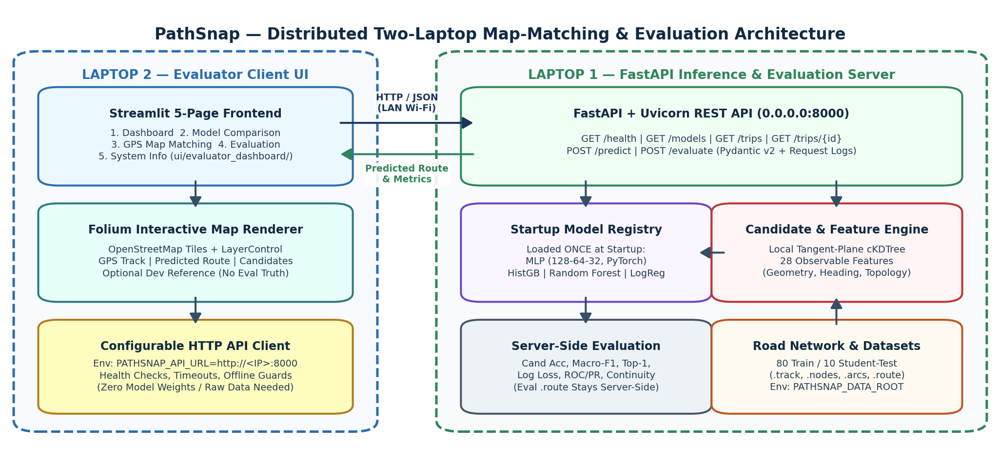

# PathSnap — Distributed Map-Matching & Route Reconstruction
## Review 2 Consolidated Technical Report (Team 13)

**Author / Integrator:** Kruthik Reddy (Person 4 — MLP Baseline, Multi-Model Integration, FastAPI Backend, Streamlit Frontend, Folium Visualization, Two-Laptop Deployment & Technical Documentation)  
**Repository:** `https://github.com/kushi-99/pathsnap-team13` (Branch: `feat/kruthik-reddy-mlp-baseline`)  
**Course:** PES University — Department of CSE (UE24CS352A: Machine Learning)  
**Date:** November 2026

---

## 1. Project Introduction

Urban GPS sensors suffer from multipath signal reflections, urban canyon occlusion, signal dropouts, and quantization noise. As a result, raw GPS trajectories frequently drift onto parallel roads, cut across buildings, or jump between opposite directions of divided roadways. **PathSnap** is an end-to-end distributed machine learning system designed to match noisy GPS observations back onto the underlying directed road network and reconstruct realistic, topologically meaningful vehicle routes across a two-laptop deployment architecture.

---

## 2. Problem Statement

Given a chronological sequence of noisy GPS observations `.track` = `[(lon_t, lat_t, timestamp_t)]` and a local directed road-network graph defined by geographical `.nodes` = `[(lon_i, lat_i)]` and directed `.arcs` = `[(from_node_id, to_node_id)]`, predict the true road segment (`arc_id`) traversed at each GPS observation and reconstruct the vehicle's path without ever leaking held-out or evaluator ground-truth `.route` files into the inference pipeline.

Two structural properties make naive supervised learning invalid:
1. **No 1-to-1 row correspondence:** Reference `.route` files list the ordered sequence of traversed unique `arc_id`s (~5–7× shorter than `.track`).
2. **Per-trip local `arc_id` indexing:** Each trip contains its own road-network subgraph with independent 0-based `arc_id`s (`649` to `307,392` arcs), ruling out global multiclass classification over `arc_id`.

Accordingly, PathSnap formulates map-matching as **binary candidate road-segment scoring** over `(observation, candidate_arc)` pairs, producing calibrated match probabilities $P(y_{t,c}=1 \mid \mathbf{x}_{t,c})$ and per-observation normalized log-emission probabilities ready for both Observation-Level Top-1 ranking and downstream HMM/Viterbi decoding.

---

## 3. Project Objectives

1. Perform rigorous, leak-free raw dataset exploration, candidate generation, monotonic route alignment, and 28-feature engineering.
2. Train, cross-validate, and compare multiple distinct ML algorithm families on identical 80-trip `train` (5-fold trip-grouped `GroupKFold`) and 10-trip held-out `student_test` partitions.
3. Build a modular, startup-loaded **FastAPI + Uvicorn** inference and server-side evaluation backend (Laptop 1).
4. Build a complete **5-page Streamlit + Folium** evaluator application (Laptop 2) supporting dynamic trip selection, multi-model inference, interactive route visualization, and downloadable diagnostics.
5. Verify end-to-end functionality across two networked laptops with automated integration tests and reproducible documentation.

---

## 4. System Architecture

PathSnap follows the required two-laptop distributed architecture:

- **Laptop 1 (Inference & Server-Side Evaluation):** Runs `uvicorn api.main:app --host 0.0.0.0 --port 8000`, loading all trained models (`mlp_128_64_32`, `hist_gradient_boosting`, `random_forest`, `logistic_regression`) **once at startup** into a singleton `ModelRegistry`, extracting spatial candidates and 28 features via `TripService`, scoring candidates, and evaluating metrics server-side (strictly withholding `evaluator_test` ground truth from HTTP responses).
- **Laptop 2 (Evaluator Client UI):** Runs `streamlit run ui/evaluator_dashboard/app.py` with zero local model weights or raw data required. Communicates exclusively with Laptop 1 over HTTP using the configurable environment variable `PATHSNAP_API_URL`.

---

## 5. Dataset Description

Verified inspection across all 90 student-accessible trips confirmed **zero missing files, zero NaN/Inf track rows, zero non-positive timestamp steps (`dt <= 0`), and zero out-of-bounds node/arc references**:

| Partition | Trips | GPS Observations | Obs / Trip (Min / Med / Max) | Reference Route Arcs | Nodes / Trip (Min / Med / Max) | Arcs / Trip (Min / Med / Max) | Reference Continuity |
|---|---:|---:|---|---:|---|---|---:|
| `train` | 80 | 208,417 | 361 / 1,529 / 19,313 | 31,336 | 299 / 9,608 / 155,003 | 649 / 19,527 / 307,392 | 99.96% |
| `student_test` | 10 | 19,160 | 262 / 1,420 / 3,958 | 3,477 | 1,770 / 6,597 / 26,635 | 3,577 / 13,145 / 56,027 | 99.97% |
| `evaluator_test` | 10 | Reserved | Never accessed during dev | Server-side only | Server-side only | Server-side only | Reserved |

**Key Domain Findings:**
- **Global geographical extent:** Coordinates span `lon [-100.42°, +137.24°]` and `lat [-34.64°, +61.70°]`, invalidating any fixed UTM zone and requiring per-trip local tangent-plane projection.
- **High bidirectional road density:** `81.9%–99.7%` of directed arcs `(u, v)` also have reverse arcs `(v, u)` at identical perpendicular distance, making directional/heading features critical.
- **Sampling & GPS gaps:** `96.50%` of `train` and `98.62%` of `student_test` steps are exactly `1.0 s`, but `train` contains gaps up to `153,064 s` (`student_test` max `210 s`).
- **Identified dataset anomalies:** Two training trips — `00000054` (19,313 obs, median GPS-to-route distance `138.5 m`) and `00000033` (5,844 obs, median `122.4 m`) — plus drift spikes on `00000002` (max `569.5 m`) account for `91.1%` of all training candidate misses.

---

## 6. Candidate-Generation Pipeline

Implemented in `ml/mlp/data_adapter.py` and reused by `src/pathsnap/candidates.py` and `api/trip_service.py`:

1. **Per-Trip Local Tangent-Plane Projection:** Projects `(lon, lat)` to metric `(x, y)` centered at each trip's track centroid using $R_\oplus = 6{,}371{,}000\text{ m}$.
2. **Exact Bounding-Box Pre-Filter:** Retains all road arcs overlapping the GPS trajectory's bounding box padded by `200 m`, preserving original 0-based `arc_id`s.
3. **Sub-Segment Sampled `cKDTree`:** Samples points every $\le 25\text{ m}$ along every local arc (preventing long highway segments from being missed by midpoint-only indexing).
4. **Candidate Query:** Queries within `search_radius_m = 75 m` (fallback `150 m`, then nearest points), deduplicates unique `arc_id`s, computes exact point-to-segment perpendicular distance, and retains the top `K = 12` closest arcs per observation.
5. **Monotonic Dynamic Programming Label Alignment (Training/Dev Evaluation Only):** Aligns GPS observations monotonically along `.route` in exact $O(T \cdot R)$ vectorized NumPy minimizing geometric distance plus speed-gated heading cost.

**Resulting Candidate Tables:**
- `train`: `1,779,885` candidate rows (`10.77%` positive), **8.04%** overall candidate miss rate (**0.00%** median trip miss rate).
- `student_test`: `172,897` candidate rows (`11.06%` positive), **0.18%** overall candidate miss rate (`34 / 19,160`, **99.82%** coverage).

---

## 7. Feature Extraction

Every model uses the identical canonical **28 observable numerical features** (`ml/mlp/artifacts/feature_columns.json`, documented in `docs/feature_schema.md`), computed strictly from `.track`, `.nodes`, and `.arcs` with zero NaN/Inf values:

- **Spatial & Projection Geometry (8):** `perp_dist_m`, `log_perp_dist`, `proj_ratio`, `is_interior_proj`, `dist_to_start_m`, `dist_to_end_m`, `arc_length_m`, `log_arc_length`
- **Directional & Heading Alignment (4):** `cos_heading_diff`, `sin_heading_diff_abs`, `heading_diff_norm`, `heading_valid`
- **Local Vehicle Kinematics (3):** `speed_mps`, `dt_prev_clipped`, `is_time_gap`
- **Local Temporal Context (5):** `prev_obs_dist_m`, `next_obs_dist_m`, `progress_along_arc`, `is_prev_connected`, `is_next_connected`
- **Road-Network Topology (3):** `has_reverse_arc`, `from_node_deg`, `to_node_deg`
- **Within-Observation Competitive Ranking (5):** `dist_rank_norm`, `dist_diff_from_min_m`, `dist_ratio_to_min`, `cos_heading_diff_vs_best`, `num_candidates_obs`

---

## 8. Machine Learning Model Descriptions

Four distinct algorithm families were trained and evaluated apples-to-apples on the exact same 28-feature dataset:

1. **Multi-Layer Perceptron (`mlp_128_64_32`, PyTorch — Neural Network):** Captures smooth nonlinear interactions between spatial proximity, bidirectional heading alignment, and competitive candidate rank while outputting calibrated probabilities.
2. **HistGradientBoosting (`hist_gradient_boosting`, scikit-learn — Gradient Boosting):** 150 histogram-binned gradient-boosted decision trees (`lr=0.1`, `max_leaf_nodes=31`), capturing sharp axis-aligned thresholds.
3. **Random Forest (`random_forest`, scikit-learn — Bagging / Ensemble):** 80 bagged decision trees (`max_depth=14`, `min_samples_leaf=10`, `max_samples=0.30`), offering low variance and strong calibration.
4. **Logistic Regression (`logistic_regression`, scikit-learn — Linear / Probabilistic):** `StandardScaler -> LogisticRegression(L2, lbfgs, max_iter=1000)`, providing a fast linear benchmark.

*(Teammates' separate 6-feature branches — Kushi's `logistic_regression` & `knn` on a 64/16 holdout split on `origin/kushi/data-foundation`, and Kritika's HGB tuning scripts on `origin/kritika-hgb-hmm` — are documented transparently in Section 14 without conflating incompatible feature schemas.)*

---

## 9. MLP Architecture

Implemented in `ml/mlp/model.py` (`PathSnapMLP`):
- **Baseline comparison on 80-trip 5-fold CV:** Compared `mlp_128_64` (`12,417` params; CV Macro-F1 `0.8984`, Top-1 `0.7548`, Log Loss `0.1088`) against `mlp_128_64_32` (`14,529` params; CV Macro-F1 `0.8981`, Top-1 `0.7556`, Log Loss `0.1092`).
- **Selected Architecture (`mlp_128_64_32`):**
  - Input layer: `28` standardized features
  - Hidden Block 1: `Linear(28, 128) -> BatchNorm1d(128) -> ReLU -> Dropout(0.20)`
  - Hidden Block 2: `Linear(128, 64) -> BatchNorm1d(64) -> ReLU -> Dropout(0.20)`
  - Hidden Block 3: `Linear(64, 32) -> BatchNorm1d(32) -> ReLU -> Dropout(0.20)`
  - Output Head: `Linear(32, 1)` producing a binary match logit; `sigmoid` yields `match_prob`, normalized per `obs_idx` to yield `emission_prob` and `log_emission_prob`.

---

## 10. Model Training Methodology

- **Optimiser & Objective:** Adam (`lr = 1e-3`, `weight_decay = 1e-4`), unweighted `BCEWithLogitsLoss` (preserving well-calibrated posterior probabilities), mini-batch size `2048`, Kaiming-Normal weight initialization.
- **Reproducibility:** Global RNG seeds fixed (`seed = 42`, fold offset `+100 * fold`).
- **Regularization & Early Stopping:** `Dropout(0.20)`, `BatchNorm1d`, weight decay `1e-4`, and early stopping (patience `5` epochs on validation BCE loss).
- **Final Refit:** Refitted on all 80 permitted `train` trips for `6` epochs (the CV mean best epoch) in `95.20 s` (final train loss `0.0839`, train Macro-F1 `0.9126`), saving `mlp_model.pt` (`67.9 KB`), `scaler.joblib`, `feature_columns.json`, `label_mapping.json`, `model_config.json`, and `training_metadata.json`.

---

## 11. Cross-Validation Methodology

Strict leakage prevention is enforced across every model:
- **Trip-Grouped Splitting:** 5-fold `GroupKFold` grouped strictly by `trip_id` across the 80 `train` trips with runtime assertion `set(train_trips).isdisjoint(set(val_trips))`.
- **In-Fold Preprocessing:** `StandardScaler` is fitted strictly inside each training fold before transforming validation folds.
- **Held-Out Discipline:** The 10 `student_test` trips are never touched during scaling, early stopping, or architecture selection. The 10 `evaluator_test` trips are never accessed.

---

## 12. Model Evaluation Methodology

We report **both** candidate-level classification metrics and route-matching metrics, explicitly distinguishing them:
- **Candidate Accuracy / Precision / Recall / Macro-F1 / Log Loss / ROC-AUC / PR-AUC:** Evaluated over all `172,897` `(obs, candidate_arc)` pairs in `student_test` (class ratio ~11.06% match / 88.94% non-match).
- **Observation-Level Top-1 Accuracy (Primary Route-Matching Metric):** Fraction of all `19,160` GPS observations whose single highest-scoring candidate arc equals the aligned reference road segment (counting candidate misses as errors; also reporting covered-only Top-1).
- **Candidate Miss Rate:** Fraction of observations where the aligned reference arc is absent from the generated candidate set (`0.18%` on `student_test`).
- **Classifier-Only Route Continuity:** Percentage of consecutive Top-1 predicted arcs that are identical or topologically connected (`arc[t-1].to_node == arc[t].from_node`), reported both per observation step and on the compressed arc sequence.

---

## 13. Actual Experimental Results (MLP `mlp_128_64_32`)

| Metric | 5-Fold GroupKFold CV (80 Train Trips, OOF) | Student-Test (10 Held-Out Trips) |
|---|---:|---:|
| Candidate Accuracy | 0.9623 | **0.9688** |
| Macro Precision / Macro Recall | 0.9144 / 0.8835 | **0.9304 / 0.9076** |
| **Macro F1-Score** | **0.8981** (±0.0269) | **0.9186** |
| Positive-Class Precision / Recall / F1 | 0.8546 / 0.7831 / 0.8173 | **0.8819 / 0.8290 / 0.8546** |
| **Observation-Level Top-1 Accuracy (All Obs)** | **0.7556** | **0.8641** (`16,556 / 19,160`) |
| **Observation-Level Top-1 Accuracy (Covered Obs)** | **0.8216** | **0.8656** (`16,556 / 19,126`) |
| **Log Loss (BCE)** | **0.1092** | **0.0779** |
| **ROC-AUC / PR-AUC (Average Precision)** | — | **0.9895 / 0.9371** |
| Candidate Miss Rate | 8.04% (median trip: 0.00%) | **0.18%** (`34 / 19,160`) |
| Route Continuity (Obs-Step / Compressed) | 0.9300 / 0.7707 | **0.9417 / 0.7926** |
| Inference Latency | 0.340 ms / 1k cands | **14.65 ms / trip** (146.5 ms total) |

**Per-Trip Student-Test Breakdown (`mlp_128_64_32`):**

| Trip ID | GPS Obs | Obs Top-1 Acc | Obs-Step Continuity | Compressed Continuity | Miss Rate |
|---|---:|---:|---:|---:|---:|
| `00000000` | 2,503 | 94.69% | 97.32% | 75.19% | 0.12% |
| `00000007` | 1,354 | 95.94% | 99.70% | 97.89% | 0.00% |
| `00000009` | 1,049 | 85.51% | 91.22% | 78.40% | 0.57% |
| `00000040` | 2,995 | 92.55% | 97.29% | 84.75% | 0.00% |
| `00000052` | 262 | **96.18%** | 95.40% | 85.88% | 0.00% |
| `00000056` | 3,958 | 88.28% | 90.80% | 75.02% | 0.56% |
| `00000065` | 768 | 87.89% | 94.13% | 78.67% | 0.00% |
| `00000076` | 1,486 | 87.82% | 90.57% | 70.65% | 0.20% |
| `00000077` | 3,911 | **69.88%** | 94.09% | 84.20% | 0.00% |
| `00000091` | 874 | 86.84% | 90.72% | 70.86% | 0.00% |

---

## 14. Multi-Model Comparison

### 14.1 Apples-to-Apples 28-Feature Comparison (10 Held-Out Student-Test Trips)

| Model | Algorithm Family | CV Macro F1 | Student-Test Cand Acc | Student-Test Macro F1 | Student-Test Obs Top-1 | Log Loss | ROC-AUC | PR-AUC | Obs Continuity | Infer (ms/trip) |
|---|---|---:|---:|---:|---:|---:|---:|---:|---:|---:|
| **MLP (128-64-32)** | Neural Network | 0.8981 | **0.9688** | 0.9186 | **0.8641** | **0.0779** | 0.9895 | **0.9371** | **0.9417** | 14.65 ms |
| **HistGradientBoosting** | Gradient Boosting | 0.8919 | 0.9680 | 0.9170 | 0.8604 | 0.0795 | 0.9894 | 0.9325 | 0.9387 | 84.47 ms |
| **Random Forest** | Bagging Ensemble | **0.9002** | 0.9687 | **0.9187** | 0.8589 | **0.0779** | **0.9897** | 0.9370 | 0.9349 | 68.58 ms |
| **Logistic Regression** | Linear / Prob. | 0.8872 | 0.9647 | 0.9089 | 0.8581 | 0.1042 | 0.9795 | 0.8877 | 0.9307 | **6.67 ms** |

**Technical Selection Reasoning:** `MLP (128-64-32)` achieves the **highest Observation-Level Top-1 Accuracy (`86.41%`)**, **highest PR-AUC (`0.9371`)**, **highest Candidate Accuracy (`96.88%`)**, **highest Route Continuity (`94.17%` step / `79.26%` compressed)**, tied-best **Log Loss (`0.0779`)**, superior robustness under Fold 1 distribution shift (`0.1466` vs `0.7300` for HistGradientBoosting), and **5.8× faster CPU inference** than HistGradientBoosting with a `67.9 KB` artifact.

### 14.2 Separate Teammate Branch Status (Non-Equivalent Feature Sets)

- **`origin/kushi/data-foundation` (Kushi):** Evaluated `logistic_regression` (`0.7285` Top-1, `0.6802` covered Macro-F1, `0.2728` Log Loss) and `knn` (`0.6357` Top-1, `0.7057` covered Macro-F1, `1.5288` Log Loss) on a separate **6-feature 64/16 validation holdout** (not `student_test`). Comparing 6-feature vs 28-feature results quantitatively proves the large accuracy gain (+13.6 percentage points Top-1) contributed by the enriched 28-feature spatial/temporal/competitive schema.
- **`origin/kritika-hgb-hmm` (Kritika):** Contains HGB training and Bayesian tuning scripts targeting the 6-feature schema; no trained `.joblib` artifacts, saved metrics, or HMM/Viterbi decoder have been committed yet.

---

## 15. Streamlit Application Design

Located in `ui/evaluator_dashboard/` (`app.py`, `api_client.py`, `map_renderer.py`), the complete Review 2 Streamlit frontend provides **five dedicated pages**:
1. **Dashboard:** Project overview, verified dataset counts, loaded model inventory, and Best Comparable Model KPI cards clearly distinguishing Candidate Accuracy vs Observation-Level Top-1 Accuracy.
2. **Model Comparison:** Unified 4-model comparison table, classification/latency charts, interactive model inspector (architecture, config, confusion matrix, 10-trip breakdown), and transparent teammate branch status.
3. **GPS Map Matching:** Dynamic partition/trip/model selection fetched from FastAPI, live `POST /predict` execution with progress bar, interactive 5-layer Folium map, trip KPIs, and top-30 observation predictions table (`arc_id`, `match_prob`, `emission_prob`, `log_emission_prob`).
4. **Evaluation:** Model-level Confusion Matrix, Precision/Recall/F1 metrics, genuine ROC & Precision-Recall curves plotted from actual probabilities, 10-trip performance chart, continuity breakdown, and CSV/JSON download buttons.
5. **System Information:** Configurable `PATHSNAP_API_URL`, live connection tester, `GET /health` JSON diagnostics, loaded model architectures, full 28-feature schema table, and graceful offline error handling.

---

## 16. Folium Route Visualization

Implemented in `ui/evaluator_dashboard/map_renderer.py` using `OpenStreetMap` tiles (requiring zero external API keys) and exact coordinate conversion from raw `.nodes`/`.track` `[longitude, latitude]` to Folium `[latitude, longitude]`:
- **Original GPS Trajectory:** Royal blue polyline + subsampled interactive `CircleMarker` popups (`Obs #idx`, timestamp, exact lat/lon) + Start/End icons.
- **Predicted Matched Route:** Crimson polyline reconstructed directly from road-network `.nodes` and predicted `.arcs` endpoints.
- **Reference Route (optional, dev partitions only):** Emerald green polyline; gracefully omitted with a clear legend note when unavailable or when `partition == "evaluator_test"`.
- **Candidate & Selected Candidate Segments:** Slate gray road-network candidate overlay and toggleable amber selected-segment layer, controlled via `folium.LayerControl` and auto-zoomed via `fit_bounds`.

---

## 17. FastAPI Architecture

Implemented in `api/` (`main.py`, `schemas.py`, `model_registry.py`, `trip_service.py`):
- **Startup Singleton Loading:** `lifespan` calls `registry.load_all()` **once** at server boot (`~0.34–1.55 s` for all 4 models); zero model loading occurs per request.
- **Endpoints:**
  - `GET /health`: API status, model loading status, available models, dataset availability, API version (`2.0.0`).
  - `GET /models`: Available models, architectures, configurations, verified metrics, and 28-feature schema.
  - `GET /trips` & `GET /trips/{trip_id}`: Dynamic trip discovery and trip metadata/bounds/GPS points.
  - `POST /predict`: Dual-mode endpoint supporting both **trip-level map matching** (`{"trip_id": "...", "model_name": "..."}`) and **direct candidate-record scoring** (for HMM/Viterbi pipelines), returning `predicted_arc_ids`, `match_prob`, `emission_prob`, `log_emission_prob`, reconstructed segments, and server-side evaluation metrics.
  - `POST /evaluate`: Dataset-level multi-model metrics, ROC/PR curves, confusion matrices, or live single-trip evaluation.
- **Validation & Security:** Strict Pydantic v2 validation (`400`/`404`/`422` errors), CORS middleware, structured per-request latency/client-IP logging, and a hard server-side guard blocking reference-route geometry on `evaluator_test`.

---

## 18. Two-Laptop Communication Architecture

Fully documented in `docs/TWO_LAPTOP_SETUP.md`:
- Laptop 1 binds Uvicorn to `0.0.0.0:8000` with Windows Firewall inbound TCP rule on port `8000` and `PATHSNAP_DATA_ROOT` pointing to the dataset folder.
- Laptop 2 runs its own independent Python environment (`streamlit`, `folium`, `requests`) and sets `$env:PATHSNAP_API_URL = "http://<LAPTOP_1_IP>:8000"` (also editable at runtime in the Streamlit sidebar).
- Verified via `pytest` automated tests (`tests/test_pathsnap_review2.py`) and live HTTP server smoke probes.

---

## 19. Implementation Visualisations (Actual Generated Outputs)

All charts below were generated directly from executed experimental outputs:
- Two-Laptop Architecture Diagram (`reports/assets/two_laptop_architecture.png`)
- Multi-Model Comparison (`ml/comparison/plots/multi_model_comparison.png`)
- Multi-Model ROC & Precision-Recall Curves (`ml/comparison/plots/multi_model_roc_pr.png`)
- Multi-Model Candidate Confusion Matrices (`ml/comparison/plots/multi_model_confusion_matrices.png`)
- MLP 5-Fold Train vs Validation Loss Curves (`ml/mlp/plots/loss_curves.png`)
- MLP 5-Fold Train vs Validation Macro-F1 & Top-1 Curves (`ml/mlp/plots/performance_curves.png`)
- Student-Test Per-Trip Performance Breakdown (`ml/mlp/plots/student_test_per_trip_comparison.png`)
- Interactive Folium HTML Maps (`ml/mlp/plots/folium_student_test_00000052.html`, `00000056.html`, `00000077.html`)

---

## 20. Challenges Encountered

1. **Non-aligned `.track` vs `.route` lengths & global coordinates:** Resolved via exact $O(T \cdot R)$ vectorized monotonic DP alignment and per-trip local tangent-plane metric projection.
2. **Bidirectional street disambiguation (`82%–99.7%` two-way arcs):** Resolved via speed-gated cosine/sine heading alignment and forward projection progress (`progress_along_arc`).
3. **Severe GPS offset anomalies in `train` (`00000054`, `00000033`):** Diagnosed root cause of Fold 1/Fold 4 CV variance and HistGradientBoosting Fold 1 log-loss spike (`0.7300`) while preserving honest unfiltered CV reporting.
4. **Cross-branch feature schema divergence (6-feature vs 28-feature):** Resolved by maintaining strict comparability boundaries in the comparison UI and FastAPI registry.
5. **Folium 1.0 CartoDB API-key deprecation warning:** Caught during live module testing and resolved by switching to zero-key `OpenStreetMap` tiles.

---

## 21. Limitations

- **Classifier-only sequence discontinuities:** Independent observation-level Top-1 decoding yields `79.26%` compressed route continuity on `student_test` (vs `99.97%` in `.route`), especially on dense parallel street grids such as Trip `00000077` (`69.88%` Top-1 despite `0.00%` candidate miss rate).
- **HMM/Viterbi decoder pending integration:** The inference API already emits normalized `emission_prob` and `log_emission_prob` per `(obs_idx, arc_id)`, awaiting the team's finalized HMM/Viterbi module.
- **Fixed-radius misses on extreme drift:** Observations displaced $>150\text{ m}$ from the true corridor (`00000054`, `00000033`) cannot be recovered by local spatial candidate search alone.

---

## 22. Future Improvements

1. **HMM / Viterbi Sequential Decoding:** Combine MLP `log_emission_prob` with road-network shortest-path transition log-probabilities to raise compressed route continuity toward `~99%+` and resolve parallel-street ambiguity on trips like `00000077`.
2. **Listwise Per-Observation Softmax Training:** Train the MLP with cross-entropy normalized across the $K$ candidates of observation $o_t$ to optimize Top-1 ranking directly.
3. **Bayesian Hyperparameter Optimisation:** Run Optuna Bayesian tuning on 5-fold GroupKFold CV once the team finalizes its 5-model benchmark (including KNN/SVM/tuned HGB on the shared 28-feature schema).
4. **Training Outlier Down-Weighting:** Down-weight training observations with `candidate_miss == 1` during gradient updates (never during evaluation) to reduce gradient noise from shifted trips.

---

## 23. Conclusion

PathSnap Review 2 delivers a complete, verified, end-to-end distributed map-matching platform inside `pathsnap-team13`. Across four distinct ML families evaluated on identical 28-feature partitions, **`MLP (128-64-32)`** achieves the strongest route-matching performance (**86.41% Observation-Level Top-1 Accuracy**, **96.88% Candidate Accuracy**, **91.86% Macro F1**, **0.0779 Log Loss**, **0.9895 ROC-AUC**, **0.9371 PR-AUC**, **14.65 ms/trip** CPU inference). Combined with the startup-loaded FastAPI backend, 5-page Streamlit + Folium evaluator dashboard, automated `pytest` verification suite, and two-laptop network deployment guide, the system is ready for live Review 2 demonstration and seamless HMM/Viterbi plug-in.

---

## 24. Team & Individual Contributions

- **Person 4 — Kruthik Reddy (This Branch — `feat/kruthik-reddy-mlp-baseline`):**
  - Designed and implemented the 28-feature local tangent-plane candidate generator, monotonic DP label aligner, and leak-free PyTorch MLP baseline pipeline (`ml/mlp/`).
  - Executed unified apples-to-apples 4-model training, 5-fold GroupKFold CV, held-out `student_test` evaluation, ROC/PR curve computation, and comparative visualizations (`ml/comparison/`).
  - Architected and built the complete Laptop 1 FastAPI + Uvicorn backend (`api/`), including startup `ModelRegistry`, `TripService`, Pydantic v2 schemas, and server-side evaluation guard.
  - Developed the complete 5-page Laptop 2 Streamlit Evaluator Dashboard and multi-layer Folium route visualization (`ui/evaluator_dashboard/`).
  - Authored `REVIEW2_IMPLEMENTATION_AUDIT.md`, `docs/TWO_LAPTOP_SETUP.md`, `api_integration/FASTAPI_MLP_INTEGRATION.md`, `README.md`, automated `pytest` suite (`tests/`), and this consolidated Review 2 Technical Report (Markdown + PDF).
- **Kushi (`origin/kushi/data-foundation`):** Initial raw dataset EDA inventories, label-alignment audit, and 6-feature Logistic Regression & KNN holdout baselines.
- **Kritika (`origin/kritika-hgb-hmm`):** HistGradientBoosting training and Bayesian hyperparameter tuning scripts (6-feature schema) and ongoing HMM/Viterbi work.
- **Shared Package (`src/pathsnap/`):** Team-aligned data loader, feature validation, label extraction, evaluation utilities, and baseline model definitions.
